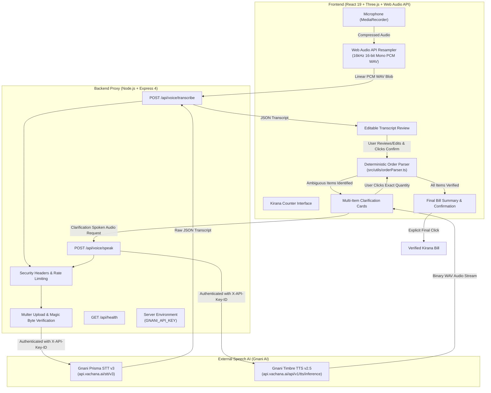

# BOLPROOF (बोलप्रूफ)

> **Voice-Order Verification for Indian Kirana Stores**  
> *“A voice order should never be a guess.”*

[](#technology-stack)
[](#technology-stack)
[](#technology-stack)
[](#technology-stack)
[](#technology-stack)
[](#running-tests)

---

## Table of Contents
- [1. The Problem](#1-the-problem)
- [2. The BOLPROOF Solution](#2-the-bolproof-solution)
- [3. Key Features](#3-key-features)
- [4. Visual Demo](#4-visual-demo)
- [5. System Architecture](#5-system-architecture)
- [6. How an Order Moves Through BOLPROOF](#6-how-an-order-moves-through-bolproof)
- [7. Gnani AI Voice Integration](#7-gnani-ai-voice-integration)
- [8. Technology Stack](#8-technology-stack)
- [9. Repository Structure](#9-repository-structure)
- [10. Quick Start & Local Setup](#10-quick-start--local-setup)
- [11. Running Tests & Quality Checks](#11-running-tests--quality-checks)
- [12. Security & Privacy Guarantees](#12-security--privacy-guarantees)
- [13. Project Documentation](#13-project-documentation)
- [14. Known Limitations & Roadmap](#14-known-limitations--roadmap)
- [15. Contributing & License](#15-contributing--license)

---

## 1. The Problem

In millions of neighborhood **kirana** stores across India, grocery ordering happens in rapid, colloquial spoken Hindi and Hinglish. In noisy shop environments with street traffic, fan hum, and overlapping chatter, customers casually speak incomplete or ambiguous orders:

> *“भैया, आधा चीनी, एक नमक और ३ सरसों तेल दे देना।”*  
> *(Brother, give half sugar, one salt, and 3 mustard oil.)*

### Why standard voice assistants and automated billing fail:
1. **Silent Guesswork:** Conventional voice apps silently guess missing units (e.g., turning *"half sugar"* into 2 kg or defaulting to whatever is in inventory).
2. **Cross-Item Bleed:** Language models or crude parsers frequently leak quantities across items (e.g., attaching the *"two kilos"* from sugar to the adjacent salt).
3. **Liquid vs. Solid Confusion:** Liquid staples like mustard oil get assigned mass units (`kg`) instead of volume (`L`, `ml`).
4. **Premature Finalization:** Raw speech-to-text transcripts are rushed directly into billing before the shopkeeper can review errors, resulting in wrong items, customer disputes, and awkward returns.

---

## 2. The BOLPROOF Solution

BOLPROOF introduces an **explicit, deterministic verification layer** between acoustic speech recognition and final order confirmation:

- **Human-in-the-Loop Transcript Review:** The shopkeeper views and can freely edit the recognized text before any order processing begins.
- **Deterministic Boundary Segmentation:** Clauses are separated at conjunctions and quantity words, guaranteeing zero cross-item contamination.
- **Targeted Multi-Item Clarification:** Every ambiguous item generates an independent visual and spoken clarification question (*“चीनी कितनी चाहिए—500 g, 1 kg या 2 kg?”*).
- **Explicit Final Confirmation:** No bill is finalized until all items have explicit units and the shopkeeper explicitly clicks confirmation.

---

## 3. Key Features

| Feature | Description |
|---|---|
| 🎙️ **In-Browser Acoustic Capture** | Captures microphone audio using MediaRecorder and decodes it via the Web Audio API into 16,000 Hz 16-bit linear PCM mono WAV without external binaries. |
| ⚡ **Gnani Prisma STT Integration** | Routes audio through a secure backend proxy to Gnani Prisma STT v3 for accurate Devanagari Hindi transcription. |
| ✍️ **Editable Transcript Interface** | Gives the shopkeeper immediate visibility into what was heard and enables quick keyboard/touch corrections. |
| 🔍 **Deterministic Semantic Parser** | Identifies items, maps Hindi fractions (`आधा`, `पाव`, `डेढ़`, `ढाई`, `सवा`), and isolates each item clause cleanly. |
| ⚖️ **Liquid vs. Solid Unit Taxonomy** | Categorizes staples by physical state: solid staples (`चीनी`, `नमक`) prompt for `g`/`kg`, while liquids (`सरसों तेल`) strictly prompt for `ml`/`L`. |
| ❓ **Independent Clarification Cards** | Resolving one ambiguous item never accidentally resolves others. Each item has its own card and options. |
| 🔊 **Gnani Timbre TTS Spoken Prompts** | Plays natural Hindi clarification audio via Gnani Timbre TTS v2.5 (`Nalini` voice model) at the touch of a button. |
| 🛒 **3D Kirana Counter Experience** | Implements an interactive Three.js 3D counter digital twin complete with digital scale weight synchronization. |
| 🔒 **Hardened Backend API** | Features in-memory sliding-window rate limiting, audio buffer magic-byte validation, and strict CORS controls. |

---

## 4. Visual Demo

<!-- Placeholder for Kirana UI Screenshot or GIF -->
```
+----------------------------------------------------------------------------------------------------+
|  BOLPROOF: KIRANA VOICE ORDER VERIFICATION                                                         |
+--------------------------------------------------+-------------------------------------------------+
|  LEFT COLUMN: REAL VOICE ORDER                   |  RIGHT COLUMN: INTERACTIVE DEMO (BASELINE)      |
+--------------------------------------------------+-------------------------------------------------+
|  [ Record Voice ] [ Stop ]                       |  Sample Spoken Order:                           |
|  Recognized Transcript:                          |  “भैया, दो किलो चीनी और एक नमक दे देना।”        |
|  "आधा चीनी एक नमक 3 सरसों तेल ऑर्डर करना है"     |                                                 |
|                                                  |  Draft Order:                                   |
|  [ Confirm Order (ऑर्डर पुष्टि एवं जांच) ]        |  - चीनी — 2 kg [Verified ✓]                     |
|                                                  |  - नमक — मात्रा स्पष्ट नहीं है [Unclear ⚠️]     |
|  Clarification Required:                         |                                                 |
|  1. चीनी: “चीनी कितनी चाहिए?”                    |  Question: “नमक कितना चाहिए?”                   |
|     [ 500 g ]  [ 1 kg ]  [ 2 kg ]                |  [ 500 g ]  [ 1 kg ]  [ 2 kg ]                  |
|  2. नमक: “नमक कितना चाहिए?”                      |                                                 |
|     [ 500 g ]  [ 1 kg ]  [ 2 kg ]                |  [ Finalize Order ]                             |
|  3. सरसों तेल: “सरसों तेल कितना चाहिए?”          |                                                 |
|     [ 500 ml ] [ 1 L ]  [ 2 L ]  [ 5 L ]         |                                                 |
+--------------------------------------------------+-------------------------------------------------+
```

> *Screenshots and demo recordings can be added to `docs/assets/`.*

---

## 5. System Architecture



---

## 6. How an Order Moves Through BOLPROOF

1. **Voice Input:** The shopkeeper taps **Record Voice** on their counter tablet or terminal. Audio is recorded and immediately resampled in the browser to 16,000 Hz mono 16-bit linear PCM WAV.
2. **Secure Transcription:** The audio blob is sent to `/api/voice/transcribe`. The backend proxy checks the audio magic bytes, attaches the server-held `X-API-Key-ID`, and forwards the stream to Gnani Prisma STT.
3. **Transcript Transparency:** The recognized Devanagari text is displayed in an editable box. If the speech engine misheard a brand or name, the shopkeeper edits it directly.
4. **Deterministic Analysis:** Clicking **Confirm Order** executes `parseOrderText()`:
   - Evaluates clauses sequentially without cross-item contamination.
   - Converts Hindi fractions with units into metric standards (e.g. `आधा किलो` → `500 g`, `डेढ़ किलो` → `1.5 kg`).
   - Flags bare numbers without units as `isUnclear: true` with `quantity: null`.
5. **Targeted Voice Clarification:** If any item is ambiguous, BOLPROOF renders a dedicated card. The shopkeeper can tap the speaker icon to play the spoken question via Gnani Timbre TTS.
6. **Explicit Order Confirmation:** The shopkeeper taps the clarified quantity. Once all items are verified, an itemized summary appears and the shopkeeper explicitly confirms the final order.

---

## 7. Gnani AI Voice Integration

BOLPROOF utilizes **Gnani AI** (`api.vachana.ai`) for Indic voice recognition and synthesis:

### 1. Prisma Speech-to-Text (v3)
- **Endpoint:** `POST https://api.vachana.ai/stt/v3`
- **Authentication:** `X-API-Key-ID` header (handled exclusively by backend).
- **Payload:** `multipart/form-data` with `audio_file` (16kHz PCM WAV) and `language_code: hi-IN`.
- **Handling:** Resilient fallback across multiple Gnani response schemas (`transcript`, `result.transcript`, `text`).

### 2. Timbre Text-to-Speech (v2.5)
- **Endpoint:** `POST https://api.vachana.ai/api/v1/tts/inference`
- **Authentication:** `X-API-Key-ID` header.
- **Payload:** JSON payload requesting `linear_pcm` WAV container, `Nalini` voice model, and `hi-IN` language.
- **Handling:** Receives binary WAV bytes directly and streams them to the browser with `audio/wav` headers for immediate Web Audio playback.

---

## 8. Technology Stack

- **Frontend Framework:** [React 19](https://react.dev/) + [Vite 8](https://vitejs.dev/)
- **3D Graphics & Scene:** [Three.js](https://threejs.org/) (WebGL with fallback for software renderers)
- **Styling & Fonts:** [Tailwind CSS 4](https://tailwindcss.com/) with Google Fonts (*Jaro*, *Bungee Inline*, *Nabla*, and *Poppins* for Hindi Devanagari)
- **Audio Processing:** Browser Web Audio API (`AudioContext`, `OfflineAudioContext`, procedural sound synthesizer)
- **Backend Server:** [Node.js](https://nodejs.org/) + [Express 4](https://expressjs.com/)
- **Multipart Uploads:** [Multer](https://github.com/expressjs/multer) (In-memory buffer storage with magic-byte validation)
- **Voice AI APIs:** [Gnani AI](https://gnani.ai/) (Prisma STT v3 & Timbre TTS v2.5)
- **Language & Type Checking:** TypeScript 5.8 / ES2022
- **Test Runner:** [tsx](https://github.com/privatenumber/tsx) automated assertion suites

---

## 9. Repository Structure

```
BOLPROOF/
├── docs/                               # Comprehensive project documentation
│   ├── AUDIT_REPORT.md                 # Complete architecture and vulnerability audit
│   ├── SECURITY_AUDIT.md               # Security hardening & defensive posture report
│   ├── TEST_REPORT.md                  # Test execution log (47 passing assertions)
│   ├── DESIGN.md                       # Designer & technical UI/UX specifications
│   └── PROJECT_EXPLORER.html           # Interactive standalone browser explainer
├── src/
│   ├── assets/images/                  # Kirana scene textures and assets
│   ├── components/
│   │   ├── hero/                       # Hero overlay and call-to-action components
│   │   ├── layout/                     # Responsive Navigation & Footer
│   │   ├── scene/                      # Three.js 3D Kirana counter, models, and textures
│   │   └── sections/                   # OrderDemoSection, ProblemSection, HowItWorksSection
│   ├── utils/
│   │   ├── audioRecorder.ts            # Web Audio recording & 16kHz PCM WAV encoder
│   │   ├── orderParser.ts              # Deterministic Hindi quantity parser & boundary logic
│   │   └── sound.ts                    # Zero-dependency procedural Web Audio UI sound effects
│   ├── App.tsx                         # Main React application entry
│   ├── index.css                       # Tailwind theme tokens & color variables
│   └── main.tsx                        # React DOM root mounting
├── test/
│   ├── api.test.ts                     # API security, magic byte, and rate limiter tests
│   └── orderParser.test.ts             # Hindi fraction and quantity parsing test suite
├── .env.example                        # Safe environment variable template
├── .gitignore                          # Strict source control exclusion rules
├── index.html                          # HTML shell with Google Fonts
├── package.json                        # Manifest, scripts, and dependencies
├── server.ts                           # Hardened Express voice proxy server
├── tsconfig.json                       # TypeScript compiler configuration
└── vite.config.ts                      # Vite build configuration with proxy rules
```

---

## 10. Quick Start & Local Setup

### Prerequisites
- [Node.js](https://nodejs.org/) (v18.0.0 or higher recommended)
- `npm` (v9.0.0 or higher)
- A modern web browser with Web Audio and MediaRecorder support (Chrome, Edge, Firefox, Safari)
- *(Optional)* Gnani AI API credentials for live voice recognition and synthesis

### Installation Steps

1. **Clone the repository:**
   ```bash
   git clone https://github.com/your-username/bolproof.git # TODO: replace with your repository URL
   cd bolproof
   ```

2. **Install dependencies:**
   ```bash
   npm install
   ```

3. **Configure environment variables:**
   Copy `.env.example` to `.env`:
   ```bash
   cp .env.example .env
   ```
   Edit `.env` and set your credentials:
   ```env
   PORT=3001
   GNANI_API_KEY=your_actual_gnani_key_here
   ```
   > **Note:** If you don't have a Gnani API key, you can still test the complete application using the **Try the Demo Order** interface or by pasting transcripts into the voice review box!

4. **Start the backend proxy server:**
   ```bash
   npm run server
   ```

5. **Start the frontend development server:**
   In a second terminal window:
   ```bash
   npm run dev
   ```

6. **Open in browser:**  
   Navigate to `http://localhost:3000`.

---

## 11. Running Tests & Quality Checks

BOLPROOF comes with automated tests covering parsing, Hindi fractions, unit classifications, API security, and audio magic-byte headers:

```bash
# Run the complete test suite (47 assertions)
npm run test:all

# Run order parser unit tests only
npm test

# Run backend API security & rate limiting tests only
npm run test:api

# Run TypeScript type check
npm run lint

# Build for production
npm run build
```

---

## 12. Security & Privacy Guarantees

- **No Secrets in Client Bundles:** `GNANI_API_KEY` is kept exclusively on the server. No `VITE_` private variables exist.
- **In-Memory Rate Limiting:** Voice endpoints are rate-limited to 30 requests/minute per IP to prevent API credit exhaustion.
- **Audio Header Verification:** Uploaded buffers are inspected for valid binary magic bytes (WAV, MP3, OGG, FLAC, WebM). Arbitrary binaries are rejected immediately.
- **Ephemeral Audio Processing:** Recorded audio is streamed directly in memory and never written to disk or database storage.
- **Safe Logging:** Customer voice orders and transcripts are never printed to server logs.

For full security analysis, see [docs/SECURITY_AUDIT.md](docs/SECURITY_AUDIT.md).

---

## 13. Project Documentation

Comprehensive documentation is available in the `docs/` directory:
- 📋 [Audit Report (`docs/AUDIT_REPORT.md`)](docs/AUDIT_REPORT.md) — Architectural and vulnerability findings.
- 🛡️ [Security Audit (`docs/SECURITY_AUDIT.md`)](docs/SECURITY_AUDIT.md) — Security hardening, rate limiting, and threat analysis.
- 🧪 [Test Report (`docs/TEST_REPORT.md`)](docs/TEST_REPORT.md) — Full test execution log and assertion details.
- 🎨 [Design Specifications (`docs/DESIGN.md`)](docs/DESIGN.md) — Visual design, brand palette, typography, and component specs.
- 🌐 [Interactive Project Explorer (`docs/PROJECT_EXPLORER.html`)](docs/PROJECT_EXPLORER.html) — Self-contained offline browser walkthrough.

---

## 14. Known Limitations & Roadmap

### Current Limitations
- **Indic Language Scope:** The current deterministic parser is optimized for Hindi and Hinglish grocery ordering.
- **Single-Channel Acoustic Input:** Extremely noisy environments with multiple simultaneous speakers require directional counter microphones.

### Roadmap
- [ ] Multi-lingual parser expansion (Marathi, Tamil, Telugu, Bengali, Kannada, Gujarati).
- [ ] Offline local STT fallback (Whisper.tflite / ONNX Runtime Web).
- [ ] Integration with thermal receipt printers (ESC/POS) via WebUSB / Bluetooth.
- [ ] Regional grocery product aliases database (e.g., *शक्कर* vs *चीनी*, *राई* vs *सरसों*).

---

## 15. Contributing & License

### Contributing
Contributions are welcome! Please follow these steps:
1. Fork the repository.
2. Create a feature branch: `git checkout -b feature/your-feature`.
3. Commit your changes: `git commit -m "feat: Add regional unit support"`.
4. Ensure all tests pass: `npm run test:all && npm run lint`.
5. Push to your branch and submit a Pull Request.

### License
This project is currently distributed under the **MIT License** (TODO: Confirm licensing terms). See `LICENSE` for details.

### Acknowledgements
- [Gnani AI](https://gnani.ai/) for Prisma Speech-to-Text and Timbre Text-to-SpeechIndic APIs.
- Indian neighborhood kirana storekeepers whose daily speed, resilience, and precision inspire this work.
