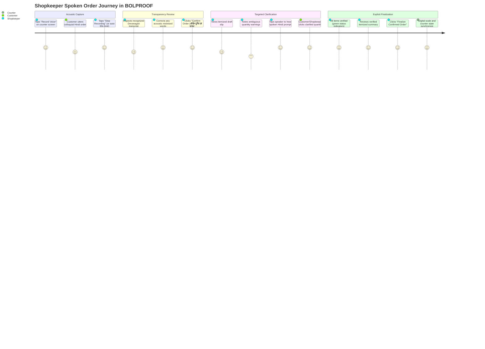

# BOLPROOF — Design System & Technical UI/UX Specifications

**Document Type:** UI/UX Design System & Technical Frontend Architecture  
**Product:** BOLPROOF (Voice-Order Verification for Indian Kirana Stores)  
**Status:** Living Design Specification (Current Implementation & Design Rationale)  

---

## 1. Product Vision & Audience

### Vision
To empower India's 12+ million neighborhood **kirana** storekeepers with an AI-free, deterministic voice verification terminal that eliminates grocery billing errors, misheard quantities, and customer returns without slowing down rapid shop-counter workflows.

### Target Audience
1. **Kirana Shopkeepers & Counter Operators:** Fast-paced retail workers who juggle multiple spoken requests simultaneously in high-decibel street environments. They need immediate visual feedback, zero cognitive overhead, and tactile, high-contrast controls.
2. **Neighborhood Customers:** Buyers speaking rapid, colloquial Hindi and Hinglish phrases (e.g. *“एक नमक”*, *“आधा तेल”*) who expect precision without interrogative friction.
3. **Open-Source Reviewers & Portfolio Observers:** Technical evaluators who require a self-explanatory, beautifully crafted, bilingual web application.

---

## 2. Core User Journey & Interaction Flow



---

## 3. Design Principles

1. **Zero Silent Assumptions (स्पष्टता):** An ambiguous order must never be guessed. If a quantity or unit is missing, the system asks targeted, single-step clarification questions rather than picking an inventory default.
2. **Radial Trust & Transparency (विश्वास):** The raw transcription is always visible and editable. Speech AI is treated as an acoustic assistant, not an infallible billing authority.
3. **Low Cognitive Load at High Speed (सरलता):** Shopkeepers cannot navigate nested dropdowns or complex modals during rush hours. Clarification options are presented as large, thumb-friendly tap targets (`500 g`, `1 kg`, `2 kg`).
4. **Physical World Continuity (किराना यथार्थ):** The interface echoes the tactile environment of a kirana shop—counter ledgers, hanging scale readouts, and physical product distinctions (solids in `g/kg`, liquids in `ml/L`).

---

## 4. Brand Palette & Color Specifications

The color palette blends traditional Indian grocery packaging warmth (warm peach, coral, pale lime) with high-contrast dark ink typography to ensure readability under direct sunlight and bright shop tubelights.

| Color Token | Hex Code | Swatch | Role & Usage |
|---|---|---|---|
| **Pale Lime** (`--color-pale-lime`) | `#EEF8CD` |  | Primary application background, canvas tone, card contrast layer |
| **Pastel Coral** (`--color-coral`) | `#FF9D9D` |  | Primary action buttons, interactive hover states, focus rings, warning accents |
| **Peach** (`--color-peach`) | `#FFC5AA` |  | Secondary button hovers, subtle borders, warm divider motifs |
| **Mint Green** (`--color-mint`) | `#BBF1D2` |  | Verified order states, success badges, confirmed scale indicators |
| **Ink** (`--color-ink`) | `#191E1B` |  | Primary high-contrast typography, top bar header background, card shadows |
| **Ink Muted** (`--color-ink-muted`) | `#49544E` |  | Secondary body copy, section labels, metadata text |
| **Ink Soft** (`--color-ink-soft`) | `#707C75` |  | Micro-copy, timestamp footnotes, helper captions |
| **Pure White** | `#FFFFFF` |  | Card containers, input backgrounds, contrast surfaces |

---

## 5. Typography System

The typography is carefully curated to bridge expressive retro signage with clean Devanagari legibility:

```
[ Nabla ]          → Brand Wordmark Logo ("BOL")
[ Jaro ]           → Hero Display & Section Headlines ("PROOF", "One unclear word...")
[ Bungee Inline ]  → Technical Badges, Item Identifiers, Category Headers
[ Poppins ]        → Hindi Devanagari Text, Body Copy, Interactive Form Elements
```

### Type Hierarchy Specifications
1. **Hero Display (`font-jaro`):**  
   `font-size: 3rem to 4.5rem`, `line-height: 1.05`, `letter-spacing: -0.02em`.  
   Used for high-impact section headlines and value propositions.
2. **Category Kicker (`font-bungee`):**  
   `font-size: 0.75rem to 0.85rem`, `letter-spacing: 0.05em`, `text-transform: uppercase`.  
   Used for section numbering (`01 · THE REALITY`), column headers, and technical labels.
3. **Hindi Spoken Content (`font-poppins` Medium / SemiBold):**  
   `font-size: 1.25rem to 1.75rem`, `line-height: 1.4`.  
   Devanagari rendering is optimized through Poppins' balanced ascender/descender metrics, ensuring matras (मात्राएँ) are never clipped.
4. **Body & Controls (`font-poppins` Regular / Bold):**  
   `font-size: 0.875rem to 1rem`, `line-height: 1.6`.  
   Used for explanations, buttons, input fields, and item ledger rows.

---

## 6. Layout Architecture: Two-Column Side-by-Side

On desktop screens (`min-width: 1024px`), BOLPROOF employs a balanced two-column grid that provides simultaneous access to both live voice input and the baseline demonstration:

```
+-------------------------------------------------------------------------------+
| TOP NAVIGATION: Brand Wordmark | 4-5 Links | "Explore the demo" Primary Button|
+-------------------------------------------------------------------------------+
| HERO: Full-Screen 100svh Three.js 3D Kirana Counter + WebGL Canvas Overlay    |
+-------------------------------------------------------------------------------+
|                                                                               |
|                   SECTION 3: ORDER VERIFICATION TERMINAL                      |
|                                                                               |
|  LEFT COLUMN: [ Voice Order ]              RIGHT COLUMN: [ Try the Demo ]     |
|  ----------------------------------------  ---------------------------------  |
|  • Audio Recording Controls (Mic / Stop)   • Baseline Sample Spoken Order     |
|  • Editable Recognized Transcript Box      • Interactive Draft Slip           |
|  • Primary "Confirm Order" Button          • Targeted Question (नमक कितना?)   |
|  • Dynamic Voice Draft Slip                • Selection Pills (500g, 1kg, 2kg) |
|  • Multi-Item Clarification Cards          • Final Confirmation Button        |
|  • Gnani Timbre TTS Audio Controls         • Independent Reset Button         |
|  • Verified Summary & Final Confirmation   • Synchronized 3D Scale Readout    |
|                                                                               |
+-------------------------------------------------------------------------------+
| SECTION 4: How BOLPROOF Works (4 Step Columns)                                |
+-------------------------------------------------------------------------------+
| SECTION 5: Product Principles (3 Cards)                                       |
+-------------------------------------------------------------------------------+
| FOOTER: Concept Manifesto, Navigation Links, Brand Palette Spec               |
+-------------------------------------------------------------------------------+
```

### Mobile Responsiveness (`< 1024px`)
- The two columns stack vertically without horizontal overflow.
- The **Voice Order** column takes natural priority at the top, followed by the **Try the Demo Order** column.
- Tap targets expand to a minimum touch area of 48×48px.
- Textareas allow vertical resizing with touch drag handles.

---

## 7. Component Inventory & States

### 1. Voice Recording Bar
- **Idle State:** Dark ink button with microphone icon (`Record Voice`).
- **Recording State:** Pulsing coral button (`Stop Recording`) with active duration timer (0–30s).
- **Transcribing State:** Disabled button with spinning loader icon (`Transcribing...`).
- **Error State:** Coral-tinted alert banner with descriptive message and retry button.

### 2. Transcript Review Box
- **Container:** White rounded box with border `#191E1B/15` and subtle inner shadow.
- **Header:** Label + convenience test link (`Paste bug test transcript`).
- **Editable Area:** Multi-line textarea styled in `font-poppins` with soft peach focus ring.
- **Helper Note:** Micro-copy reminding user: *“Speech recognition is not proof of accuracy. Review and correct words above if needed.”*

### 3. Order Verification Slip (`कच्ची पर्ची`)
- **Status Indicator:**
  - `Unclear ⚠️`: Red badge (`#9E2A2B` on `#FF9D9D/30`).
  - `Verified ✓`: Green badge (`#065F46` on `#BBF1D2`).
  - `Confirmed ✓`: Emerald badge with checkmark.

### 4. Clarification Cards
- **Card Background:** Soft pale lime tint (`#EEF8CD/40`) with peach border (`#FFC5AA`).
- **Devanagari Prompt:** Bold question (e.g. *“सरसों तेल कितना चाहिए?”*).
- **Audio Button:** Speaker icon button triggering real-time Gnani Timbre TTS playback.
- **Option Pills:** Large pill buttons with hover micro-animations and active selected state.

### 5. Final Confirmation Bar
- **Disabled State:** Muted button with warning message: *“Order cannot be finalized while any product quantity remains unresolved.”*
- **Active State:** Emerald green confirmation button (`Finalize Confirmed Order (ऑर्डर पक्का करें)`).

---

## 8. Accessibility (a11y) & Usability

1. **Color Contrast:**
   - Dark Ink (`#191E1B`) on Pale Lime (`#EEF8CD`): Contrast ratio **13.4:1** (Exceeds WCAG AAA requirement of 7:1).
   - Dark Ink (`#191E1B`) on Pastel Coral (`#FF9D9D`): Contrast ratio **6.8:1** (Exceeds WCAG AA requirement of 4.5:1).
2. **Keyboard Navigation:**
   - All interactive controls (tabs, option buttons, audio icons, reset links) have visible focus rings (`focus-visible:outline-2 focus-visible:outline-[#FF9D9D]`).
3. **Screen Readers & ARIA:**
   - Form inputs have associated `<label>` tags with matching `htmlFor` attributes.
   - Status indicators use semantic text labels in addition to colors.
4. **Reduced Motion:**
   - `@media (prefers-reduced-motion: reduce)` disables non-essential animations, pulse effects, and smooth scroll behaviors.

---

## 9. Visual Asset & Design Checklist

- [x] Full-bleed 100svh Three.js 3D Kirana counter scene with realistic lighting.
- [x] High-resolution kirana background texture (`kirana_shop_scene_*.jpg`).
- [x] Custom Web Audio procedural sound synthesizer (zero external MP3/WAV assets).
- [x] SVG iconography via `lucide-react` (Volume, Mic, ShoppingBag, CheckCircle, AlertCircle).
- [x] Responsive typography with Google Fonts (*Jaro*, *Bungee Inline*, *Nabla*, *Poppins*).
- [ ] *(Optional Future)* Dark mode high-contrast Kirana night-shift theme.
- [ ] *(Optional Future)* Animated Lottie order celebration confetti upon bill confirmation.
